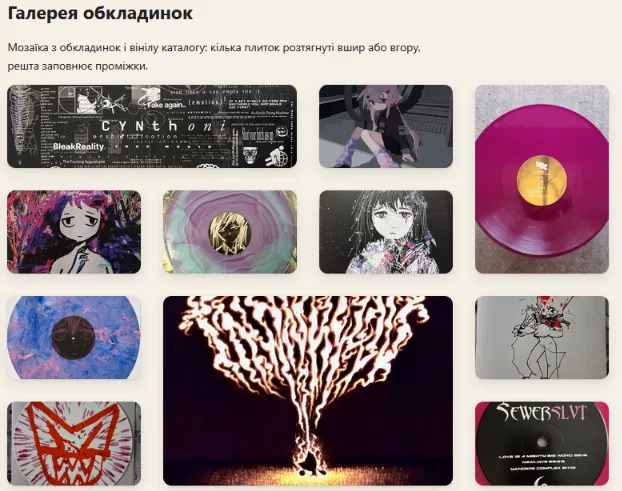
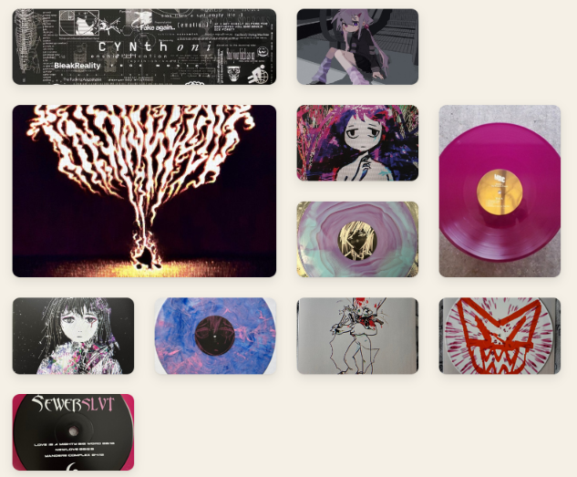
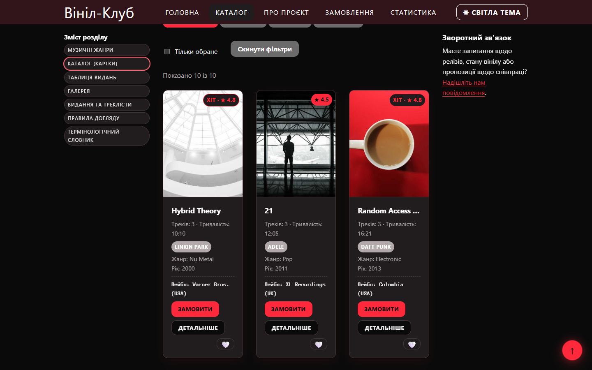
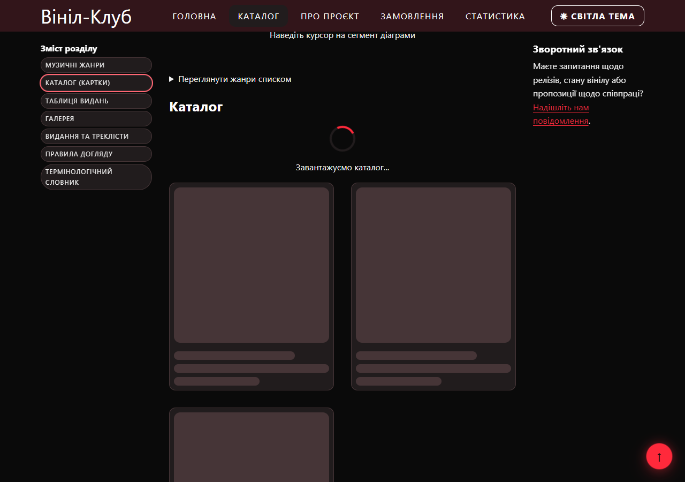
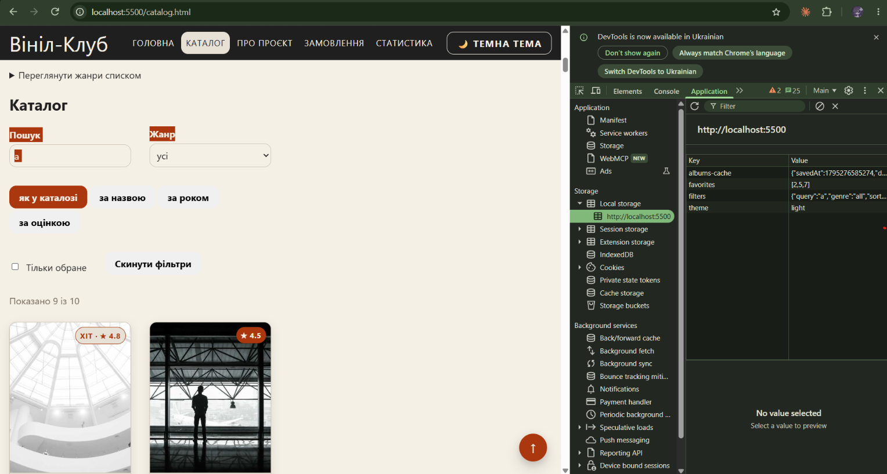

# «Вініл-Клуб» — Вебплатформа каталогу та замовлення платівок

## Інформація про роботу
* **Студент:** Царенко Юрій
* **Підгрупа:** 2
* **Варіант:** №11
* **Тема варіанта:** «Вініл-Клуб» — колекція музичних альбомів із треклістами, лейблами й оцінками слухачів. Сайт дає змогу замовити платівку з каталогу.

---

## Опис предметної області та легенда проєкту
«Вініл-Клуб» — це тематичний вебсервіс для колекціонерів та аудіофілів, що поєднує інтерактивний каталог альбомів, базу даних метаданих і можливість прямого замовлення фізичних релізів.

---

## Етапи реалізації проєкту (План курсу)

* **ЛР1 — Головна сторінка (`index.html`):** розгортання проєкту, базова семантична розмітка, опис клубу, колекції та фото вінілового програвача.
* **ЛР2 — Сторінка каталогу (`catalog.html`):** навігація по жанрах, таблиця «альбом — виконавець — рік — лейбл», інтерактивні елементи `<details>/<summary>` для перегляду треклістів.
* **ЛР3 — Форма замовлення (`form.html`):** вибір альбому (`<select>`), каталожний номер у форматі «тег-номер» (`[A-Z]{2,4}-[0-9]{3,6}`, напр. SLVT-002), радіокнопки стану (нова / б/в), лічильник кількості, опції доставки, чекбокси додаткових послуг (захисний конверт, постер, подарункове паковання) та згода на обробку.
* **ЛР4 — Стилізація та ретро-палітра:** візуальне оформлення у відтінках чорного вінілу, кремового конверта та теплих помаранчевих акцентів. Моноширинний шрифт для назв треків і колонок тривалості.
* **ЛР5 — Компоненти карток:** квадратні обкладинки альбомів, метадані релізів, каталожний номер та динамічний бейдж «Класика» для видань, старших за 20 років.
* **ЛР6 — Сітка та модальні вікна:** CSS Grid розмітка, бічна панель `aside` з фільтрацією за жанрами, модальне вікно на базі `<dialog>` для треклісту.
* **ЛР7 — Адаптивність та мікроанімації:** mobile-first макет (1 → 2 → 3 колонки), мобільне меню без JavaScript, ефекти карток, анімація модальних вікон і спінер із підтримкою `prefers-reduced-motion`.
* **ЛР8 — Обчислювальна логіка (JS):** парсинг рядків тривалості формату `"3:36"`, підрахунок загального хронометражу платівки, пошук найдовшого треку та розрахунок середнього рейтингу альбому.
* **ЛР9 — Інтерактивність та валідація:** динамічний рендеринг карток, живий пошук за назвою чи автором, фільтри за десятиліттями, делегування подій і клієнтська валідація форми замовлення.
* **ЛР10 — Фінальний реліз:** асинхронне завантаження бази через `fetch("data.json")`, повноцінні модалки релізів із метаданими лейбла і треклістами, збереження списку обраного в `LocalStorage` («моя колекція»).


Дослідження HTTP-запитів

Під час відкриття сторінки через Live Server та її оновлення браузер виконав 4 окремі запити:

1. початковий запит на отримання структури самого HTML-документа.
2. службове з'єднання розширення Live Server для гарячого оновлення сторінки у реальному часі.
3. запит на завантаження картинки платівки для контентної частини.
4. запит на завантаження іконки сайту для вкладки браузера.

Протокол HTTP працює за принципом окремих запитів на кожен ресурс, браузер не отримує весь сайт одразу в одному пакеті.
Спочатку надсилається перший запит лише на сам HTML-документ (index.html).
Під час парсингу отриманого HTML-дерева браузер натрапляє на посилання на зовнішні ресурси і автоматично формує додаткові паралельні HTTP-запити до сервера за кожним файлом окремо.
Крім того, Live Server автоматично додає у сторінку свій скрипт відстеження змін, який ініціює додаткове WebSocket-з'єднання


# Звіт до бонусних завдань (ЛР2, Варіант №11)

### 1. Аналіз завантаження `<picture>` у DevTools Network
Під час тестування у сучасному браузері (Chromium) вкладка Network зафіксувала запит виключно до файлу `breakcore-pod-vodochku-vinyl.webp`. Браузер успішно визначив підтримку сучасного формату WebP через атрибут `type="image/webp"` першого джерела `<source>` і не завантажував важчий растровий файл `.jpg`, заощадивши трафік.

### 2. Результати перевірки доступності (Accessibility)
* **Клавіатурна навігація:** обхід сторінки клавішею `Tab` відбувається послідовно: спочатку елементи шапки та головне меню, потім локальний зміст, картки видань та розкривні елементи `<details>`, які відкриваються/закриваються клавішами `Enter` і `Пробіл`.
* **Дерево доступності (DevTools -> Accessibility):** у порівнянні з ЛР1, дерево структуровано семантичними ролями HTML5 (`navigation`, `table`, `group`, `figure`, `article`), заголовки утворюють чітку ієрархію без розривів, а навігаційні блоки чітко розрізняються скрінрідерами завдяки унікальним атрибутам `aria-label` («Головне меню» та «Навігація по сторінці»).

## Перевірка валідатором W3C

| Сторінка | Errors до | Errors після | Що виправлено |
|---|---|---|---|
| index.html | 0 | 0 | — |
| catalog.html | 2 | 0 | Видалено зайві дубльовані закривальні теги tbody та table |
| about.html | 0 | 0 | — |
| form.html | 0 | 0 | — |

### Чому клієнтської валідації недостатньо
Клієнтська валідація працює суто в браузері для зручності користувача. Під час тестування через DevTools будь-який обов'язковий атрибут або обмеження легко видаляються з розмітки за кілька секунд, що дозволяє відправити порожні або некоректні дані в обхід перевірок. Також зловмисник може надіслати підроблений HTTP POST-запит напряму до сервера в обхід сторінки.


### 1. Відмінність `<datalist>` від `<select>`
- **`<datalist>`** слугує гнучким списком рекомендацій (автодоповнення) для поля `<input>`: користувач може як обрати запропонований варіант зі списку, так і ввести будь-яке власне значення з клавіатури, якщо потрібного пункту немає.
- **`<select>`** створює строго фіксований випадний список: користувач зобов'язаний обрати лише один (або кілька) із визначених тегів `<option>` і не має технічної змоги ввести власне довільне значення.
### 2. Псевдоклас `:focus:invalid` проти `:invalid`
Якщо використати селектор без фокусу (`input:invalid`), браузер підсвітить червоним кольором усі незаповнені обов'язкові поля відразу після завантаження сторінки, що створює зайвий візуальний тиск на користувача ще до початку взаємодії. Псевдоклас `:focus:invalid` активує індикацію помилки тільки в момент, коли користувач тримає фокус на конкретному полі й ввів некоректні дані, забезпечуючи дружній та доречний зворотний зв'язок.

### 3. Завантаження файлів (`type="file"`) та обмеження методу GET
Поле типу `file` передає бінарний масив даних самого файлу. Метод `GET` передає параметри суто у вигляді текстового рядка запиту в URL-адресі, яка має жорсткі ліміти довжини та не підтримує передачу бінарних потоків даних. Передати файл через URL неможливо, тому завантаження файлів вимагає виключно методу `POST` у парі з заголовком `enctype="multipart/form-data"`, який розбиває тіло HTTP-запиту на окремі частини для текстових даних і бінарних файлів.

### 4. Дослідження панелі Network (GET проти POST)
При відправленні форми методом `GET` усі введені значення відкрито дописуються в URL-адресу після знака `?` і відображаються у панелі Network як Query String Parameters. При використанні методу `POST` адреса залишається незмінною, а дані розміщуються всередині тіла HTTP-запиту (секція Form Data / Payload). Паролі та чутливі дані категорично не можна передавати методом `GET`, оскільки рядок URL разом із параметрами зберігається в історії перегляду браузера, серверних журналах доступу (access logs) та передається зовнішнім ресурсам через HTTP-заголовок Referer.

---

## Оформлення

**Шрифти.**
* [Anonymous Pro](https://fonts.google.com/specimen/Anonymous+Pro) (Google Fonts, підключено через `@import` із `subset=cyrillic`, накреслення 400 і 700): моноширинний шрифт для назв треків і колонок тривалості (`.tracklist`, `pre`, `code`).
* Системний стек `system-ui, -apple-system, "Segoe UI", Roboto, sans-serif`: основний текст і заголовки (зовнішнього підключення не потребує).

**Змінні палітри (`:root`).**
* `--color-brand`: чорний вініл, шапка, заголовки, шапка таблиці.
* `--color-accent`, `--color-accent-hover`: теплий акцент, кнопки, посилання, активний пункт меню; його світліший відтінок для наведення.
* `--color-visited`: колір відвіданих посилань.
* `--color-bg`: кремовий папір, фон сторінки.
* `--color-surface`: картон конверта, фон карток, зебра таблиці, підвал.
* `--color-text`, `--color-muted`: основний і другорядний (підписи, дати) текст.
* `--color-border`: межі карток, таблиць і полів.
* `--color-highlight`: підсвітка `<mark>`; `--color-row-hover`: рядок таблиці під курсором.
* `--color-danger`, `--color-danger-bg`: помилка валідації та її фон.
* `--color-success`, `--color-success-bg`: коректно заповнене поле та його фон.
* `--color-on-dark`: білий текст на темних плашках (теги авторів, діаграма жанрів).
* Не кольори: `--font-body`, `--font-mono` (шрифти), `--radius` (скруглення), `--space`, `--space-sm`, `--space-md`, `--space-lg`, `--space-xl` (відступи), `--shadow`, `--shadow-lift` (тіні карток).

**Найскладніший селектор.** Найважче було зробити підсвітку об'єднаних рядків таблиці (`tbody tr:has(td[rowspan]):has(+ tr:hover)`): `:hover` на `<tr>` підсвічує лише один рядок, а клітинка з `rowspan` належить першому з двох. Довелося поєднати `:has()` і комбінатор `+`, щоб при наведенні на будь-який із рядків виконавця світилися обидва разом. Такий селектор читається важко, тому його пояснено коментарем у `styles.css`.

---

# Бонусні завдання ЛР4

### 1. Темна тема другим набором змінних
Блок `body.dark-theme` перевизначає лише змінні палітри (бг, поверхню, текст, бренд, акцент, межі, стани полів, підсвітки). Щоб перевірити, клас `dark-theme` додається до `<body>` вручну. У проєкті він лишається вимкненим: перемикач з'явиться разом із JavaScript.

Нових або дубльованих правил для самих елементів не знадобилося: **змінено рівно 1 правило** (цей блок із 15 змінних). Так мало, бо всі кольори в `styles.css` задані через `var(--color-…)`, а змінні на `<body>` успадковуються всіма нащадками. Виняток складають лише напівпрозорі чорний і білий у тінях: вони не належать палітрі й однакові в обох темах. Окремо довелося підібрати світліший акцент і колір відвіданих посилань, бо темні варіанти зливалися б із темним фоном.

### 2. Трюк із `:has()`
Правило `article:has(details[open])` у `catalog.html`: картка альбому з розкритим треклістом отримує акцентну рамку й піднесену тінь, а коли клікнути на `<summary>` і закрити список, виділення зникає.
Без `:has()` це довелося б робити через JavaScript: слухати подію `toggle` на кожному `<details>`, шукати найближчий `<article>` через `closest()` і додавати чи прибирати клас, а ще окремо врахувати початковий стан `<details open>` при завантаженні сторінки.

### 3. Неоморфна картка
Цитата на головній (`.neo`) має фон `var(--color-bg)`, тобто точно такий самий, як і в сторінки. Об'єм дають дві протилежні тіні: темна `rgb(0 0 0 / 15%)` зліва-вгору не виходить, вона падає знизу-справа, а світла `rgb(255 255 255 / 70%)` зверху-зліва. У стані `:active` ті самі тіні стають `inset`, і картка здається втиснутою.
Ефект розсипається, якщо змінити фон картки, але не змінити фон сторінки: неоморфізм працює лише тоді, коли картка виглядає виліпленою з того самого матеріалу, що й фон. Світла тінь видима лише на фоні, який той самий колір; на іншому фоні картка читається як звичайний кольоровий прямокутник із тінню, а `inset` дає вигляд отвору в іншому матеріалі, а не натиснутої кнопки.

### 4. Вкладеність (nesting)
Блок кнопок переписаний із вкладеними правилами та `&`: `&[type="submit"]`, `&[type="reset"]` і `&:hover` усередині кожного. Раніше префікс `button` повторювався в шести окремих правилах, а тепер усі стани кнопок згруповані в одному місці. Це читабельніше: видно, що hover належить саме цій кнопці. Специфічність не змінилась, поведінка та сама.

### 5. `::marker` і власні маркери
У списку порад на головній (`aside ul`) маркери стилізовані через `li::marker`: колір `var(--color-accent)` і розмір `1.25em`.
Різниця між двома підходами:
- `::marker` змінює лише сам маркер: колір, шрифт, розмір, `content`. Список лишається списком, а позиціонування й відступ браузер робить сам. Але можливостей небагато: немає `background`, `margin`, `padding`.
- `list-style: none` + `li::before { content: … }` дає повний контроль над виглядом (будь-який символ чи картинка, будь-яке позиціонування), але тоді відступ і вирівнювання доводиться робити вручну. До того ж у частині скрінрідерів і браузерів список без маркерів перестає озвучуватись як список, а для нумерації потрібні CSS-лічильники.
Для простого фарбування й розміру достатньо `::marker`.


---

# ЛР5 — Експерименти з CSS

### 1. object-fit

Для `.card__img` я тимчасово міняв значення `object-fit` і дивився на вертикальне зображення в картці.

- При `fill` зображення розтягується до розмірів блока, тому його пропорції спотворюються: фото виглядає сплющеним або витягнутим.
- При `contain` картинка вміщається цілою зі збереженням пропорцій, а порожні поля з боків (або зверху й знизу) з'являються тому, що пропорції фото не збігаються з пропорціями блока.
- При `cover` зображення заповнює весь блок без спотворень, а зайве по краях обрізається; саме тому лишив `cover`.

### 2. Три крапки

Для `.card__title` я по черзі закоментовував кожен з трьох рядків і оновлював сторінку.

- Без `white-space: nowrap` довга назва переноситься на кілька рядків, і картка стає вищою за інші.
- Без `overflow: hidden` текст не обрізається і вилазить за рамку картки.
- Без `text-overflow: ellipsis` назва обрізається по краю різко, без трьох крапок.

### 3. Схлопування відступів

Схлопування (margin collapse) відбувається з вертикальними відступами сусідніх блокових елементів: коли `margin-bottom` одного блока торкається `margin-top` наступного, вони не додаються, а зливаються в один, більший із двох (24px і 16px дадуть 24px, а не 40px). Горизонтальні відступи не схлопуються, як і відступи елементів `inline-block`, flex і grid. Практичне правило, яке дозволяє з цим не стикатися: задавати вертикальні відступи лише в один бік, наприклад тільки `margin-bottom` (або тільки `margin-top`), тоді схлопувати нічого.

---

### Перевірка валідатором W3C (ЛР5)

| Сторінка | Errors |
|---|---|
| index.html | 0 |
| catalog.html | 0 |
| about.html | 0 |
| form.html | 0 |

---

# Бонусні завдання ЛР5

### 1. Фіксована кнопка «Нагору»

Кнопка `.to-top` стоїть наприкінці `<body>` кожної сторінки, веде на `#top` і має `position: fixed` у правому нижньому куті. Різниця зі липкою шапкою: `fixed` повністю виймає елемент із потоку й прив'язує його до вікна, тож він завжди на одному місці екрана й не залишає після себе місця в розмітці; `sticky` лишається в потоці, поводиться як звичайний блок, доки не доскролиш до порога (`top: 0`), і лише тоді «прилипає», причому тільки в межах свого батька. Через це `id="top"` довелося перенести з `<header>` на `<body>`: якщо ціль якоря сама липка, вона вже видима у верху вікна, і сторінка нікуди не прокручується.

### 2. «Скляний» банер

У `.banner--glass` чотири фонові шари: борозни платівки, напівпрозорий градієнт, фото й суцільний колір. Найнижчий шар — суцільний колір `var(--color-surface)`, бо у списку `background` шар, записаний першим, лежить найвище, а останній найнижче. Суцільний колір може бути тільки останнім, тому що це не шар-зображення, а заливка під усіма ними (синтаксис скорочення `background` дозволяє колір лише в останньому шарі); він же виручає, якщо фото не завантажилося.

### 3. `clamp()` для заголовка

Для `h1` задано `font-size: clamp(1.6rem, 5vw, 3rem)`. Це зручніше за три окремі значення в медіазапитах: одна декларація дає плавну зміну розміру між мінімумом і максимумом без стрибків на брейкпойнтах, а медіазапити змінюють розмір ступінчасто, потребують кількох правил і окремої підтримки при кожній зміні макета.

### 4. Опис у два рядки

`.card__excerpt` обмежений через `display: -webkit-box`, `-webkit-line-clamp: 2` і `overflow: hidden`. Різниця з `text-overflow: ellipsis`: ellipsis працює лише для одного рядка (потребує `white-space: nowrap`) і обрізає текст по ширині блока, а `line-clamp` рахує рядки і дозволяє залишити два чи більше з трьома крапками наприкінці.

### 5. Контекст накладання

Правило `transform: scale(1)` на `.cards` створює новий контекст накладання (stacking context): `z-index` усіх нащадків відтепер порівнюються лише всередині `.cards`, а сам `.cards` у решті сторінки виступає одним цілим шаром. Тому шапка з `z-index: 10` лишається над усіма картками, а бейдж із `z-index: 2` змагається тільки з елементами всередині `.cards`. Збільшення `z-index` бейджа до 9999 не допомогло б, бо значення порівнюється лише в межах свого контексту: «вийти» з нього й піднятися над шапкою в зовнішньому контексті бейдж не може.

---

# ЛР6 — Макет сторінки: Grid і Flexbox

**Варіант №11:** `aside` із фільтром за жанром (у `catalog.html` радіокнопки жанрів у бічній колонці, картки ховаються через `:has()` за атрибутом `data-genres`, без JavaScript) і статична модалка `<dialog id="details">` із треклістом альбому Lamenting Malice (відкривається кнопкою «Трекліст» у першій картці, закривається кнопкою «Закрити» або клавішею `Esc`).

### Адаптивна сітка

Каталог: `grid-template-columns: repeat(auto-fit, minmax(var(--min-col), 1fr))`, де `--min-col: 260px`, а `--gap: 2rem` (32px). Плавно звужував вікно від 1600px і записував, коли змінюється кількість колонок:

| Ширина вікна | Колонок у каталозі |
|---|---|
| ширше ≈ 1378px | 3 |
| ≈ 1378px | 3 → 2 |
| ≈ 1086px | 2 → 1 |
| ≈ 900px | макет складається в одну колонку (зникають бічні nav і aside), і каталогу знову вистачає місця на 3 колонки |
| ≈ 874px | 3 → 2 |
| ≈ 582px | 2 → 1 |

Чотирьох колонок у моєму макеті не буває навіть на широкому екрані: сторінка обмежена `--page-width: 1400px`, з неї забирають дві бічні колонки по `--sidebar: 220px`, два проміжки й внутрішні відступи, тож на каталог лишається щонайбільше ≈ 864px, а чотири колонки потребують 4 × 260 + 3 × 32 = 1136px.

Звідки браузер бере ці числа без жодного медіазапиту для карток: `auto-fit` разом із `minmax(260px, 1fr)` кладе в рядок стільки колонок, скільки вміщується за умови, що кожна не вужча за 260px, тобто n колонок помістяться, поки ширина контейнера ≥ n × 260 + (n − 1) × 32 px (3 колонки — 844px, 2 — 552px). Ширина ж контейнера каталогу — це ширина вікна мінус бічні колонки, проміжки й відступи, тому поріг у пікселях вікна більший за ці 844 і 552.

**auto-fit проти auto-fill.** Коли в контейнері лишилося дві картки, з `auto-fit` вони розтягнулися на всю ширину (по ≈ 416px), а з `auto-fill` браузер зберіг третю порожню колонку, і картки лишилися вузькими (по ≈ 267px) з порожнім місцем праворуч.

### Areas

Макет `catalog.html` і `index.html` описано словами: `grid-template-areas: "nav main side" "foot foot foot"`, а кожен блок отримав свою `grid-area`. Коли я поміняв місцями `nav` і `side` у схемі, бічний зміст і фільтр перескочили на протилежні боки без жодної правки HTML, після чого повернув як було. Це доводить, що розмітка відповідає лише за зміст і порядок у документі, а розташування на екрані повністю задає CSS: одну й ту саму розмітку можна розкласти по-різному, змінивши тільки схему зон.

### Sticky і Grid

Липкий елемент може «їздити» лише в межах свого батька. Якби `<header>` лежав усередині `.layout`, його батьком стала б сітка, а сам він займав би один короткий рядок сітки заввишки з шапку: прокручувати його нікуди, тож він поїхав би вгору разом зі сторінкою й перестав прилипати. Тому `<header>` лишився поза `.layout`, прямим нащадком `<body>`: його контейнер — уся сторінка, і шапка липне на всіх сторінках. Сітка описує лише зони `nav / main / side / foot`.

### dialog

- Вікно закривається клавішею `Esc` без жодного рядка коду: це вбудована поведінка `<dialog>`, відкритого через `showModal()`.
- Поки вікно відкрите, сторінка позаду не прокручується: `body:has(dialog[open]) { overflow: hidden; }`, а все поза вікном стає неактивним.
- Затемнення тла я не створював окремим елементом: його малює псевдоелемент `.modal::backdrop` з напівпрозорим чорним кольором.
- `z-index` модалці не потрібен: вікно, відкрите через `showModal()`, потрапляє в top layer браузера, який лежить над усім вмістом сторінки, зокрема над липкою шапкою з `z-index: 10`.

### Підсвітка сітки в DevTools

Elements → `.layout` і `.cards` → значок `grid`: рожевим підсвічено макет сторінки (nav / main / side), блакитним — сітку каталогу з номерами ліній і ширинами колонок.


### Перевірка валідатором W3C (ЛР6)

| Сторінка | Errors до | Errors після | Що виправлено |
|---|---|---|---|
| index.html | 0 | 0 | — |
| catalog.html | 0 | 0 | — |
| about.html | 0 | 0 | — |
| form.html | 0 | 0 | — |

---

# Бонусні завдання ЛР6

### 1. Перемикач теми
Кнопка «Тема» стоїть у шапці кожної сторінки й перемикає клас `dark-theme` на `<body>`. Клас `.dark-theme` складається лише зі змінних: чотири з завдання (`--color-bg`, `--color-surface`, `--color-text`, `--color-accent`) та інші змінні палітри під той самий відтінок. Жодного правила оформлення не дубльовано. Колір, який був зашитий числом у неоморфній картці (тіні `.neo`), винесено у змінні `--neo-shadow-dark` і `--neo-shadow-light`, тому тема їх перевизначає.

### 2. Щільна галерея
Секція `#gallery` у `catalog.html`: `grid-template-columns: repeat(4, 1fr)`, `grid-auto-rows: 120px`, `gap: var(--gap)`, три плитки більші за інші: `wide`, `tall` і одна квадратна 2×2 (обидва класи разом), щоб обкладинка не обрізалася до вузької смужки.




Без `dense` (за замовчуванням `row`) браузер розкладає плитки строго за порядком у HTML і ніколи не повертається назад. Якщо `wide`-плитка не вміщується в залишок рядка, вона переходить у наступний, а в попередньому лишається порожня «дірка». З `dense` браузер шукає першу вільну клітинку з початку сітки й заповнює дірки дрібними плитками, що йдуть далі.
Платимо порядком: візуальний порядок плиток більше не збігається з порядком у HTML. Клавіша `Tab` і екранний читач ідуть за розміткою, а око бачить інший порядок, тому `dense` доречний лише там, де порядок елементів неважливий (галерея обкладинок).

### 3. Закріплена картка
Картка «Хіт» (Draining Love Story) стоїть у HTML третьою, а в сітці займає весь перший рядок: `grid-column: 1 / -1` + `grid-row: 1`. Порядок у розмітці не змінено, решта карток розтікається по рядках нижче.
Таким прийомом не можна виправляти неправильний порядок вмісту: `grid-row`, `grid-column` та `order` змінюють лише те, що бачить око. Екранний читач і клавіша `Tab` ідуть за порядком у DOM, тому «хіт» озвучиться третім, а `Tab` перейде до нього після двох карток, які візуально стоять нижче. Правильний порядок має бути вже в HTML, а сітка тільки підсилює візуальний акцент.

### 4. Липка бічна колонка
`.layout__aside { position: sticky; top: var(--header-offset); align-self: start; }`, де `--header-offset: 5rem`.
Без `align-self: start` липкість не працює: за замовчуванням елемент сітки має `align-self: stretch` і розтягується на всю висоту рядка, тобто стає такої самої висоти, як `main`. Липкий елемент рухається лише всередині свого контейнувального блока (тут комірки сітки), а розтягнута колонка вже займає її всю висоту, тож «їздити» їй нікуди. З `align-self: start` колонка має власну висоту й ковзає вздовж комірки.

### 5. Форма у дві колонки
Форма й кожен `fieldset` стали Grid із колонками `minmax(12rem, 18rem) 1fr`: підписи ліворуч, поля праворуч. Кожен рядок `<p>` бере ці колонки через `subgrid`, тож підписи й поля вирівнюються по одній лінії. Рядок із кнопками займає обидві колонки (`grid-column: 1 / -1`), а «Оформити замовлення» розтягнута на всю ширину. На екрані вужчому за 768px форма повертається в одну колонку.
На звичайному потоці форма не мала жодного правила розкладки (підпис, `<br>`, поле). Перебудова коштувала близько 50 рядків CSS (43 в основному блоці плюс медіазапит для вузького екрана) та кількох класів у розмітці (`form-grid`, `form__term`, `form__control`, `form__actions`).

---

## Звіт ЛР7: адаптивність, меню та рух

### Три розкладки (зі скриншотами)

Усі три схеми реалізовані mobile-first через `@media (min-width: ...)`. Картки каталогу залишаються на Grid із `auto-fit` та `minmax()`.

**Телефон, 360 px:** одна колонка; картки каталогу стають одна під одною, меню згортається у нативний `<details>`.


**Планшет, 820 px:** дві колонки макета (`main` та `aside`); меню горизонтальне, у рядку каталогу дві картки.


**Десктоп, 1440 px:** три колонки макета з бічними панелями; меню горизонтальне, у рядку каталогу три картки, ширина макета обмежена й центрована.



### Мобільне меню без JavaScript

На телефоні список посилань міститься в нативному `<details>` з інтерактивним `<summary>Меню</summary>`. Його можна розгортати клавіатурою та вказівником; керування станом не потребує JavaScript. Від 768 px показується горизонтальна навігація, а мобільний перемикач приховується. Активна сторінка позначається `aria-current="page"`.

### Що анімуємо

* Картки каталогу плавно піднімаються на `:hover` пристроїв із наведенням і на `:focus-within`; переходи змінюють лише `transform` та `opacity`.
* Нативні модальні вікна з'являються через `opacity` і `transform`; затемнення `::backdrop` плавно проявляється через `opacity`.
* Заготовлений індикатор завантаження `.spinner` обертається через `transform` з постійною швидкістю (`linear`). `ease` змусив би спінер прискорюватися й сповільнюватися. Сам індикатор залишається прихованим атрибутом `hidden`, доки майбутнє завантаження даних його не ввімкне.

### Reduced motion

За `prefers-reduced-motion: reduce` анімації та переходи скорочуються до `0.01ms`, а повторення анімацій обмежується одним. Для карток додатково вимикається підйом на `:hover` і `:focus-within`; прокручування стає миттєвим. Це зменшує непотрібний рух для людей, чутливих до анімації, та зберігає функціональність меню, карток і модальних вікон.

### Перевірка валідатором W3C

Файли перевірено локальним Nu HTML Checker — вихідними файлами не ділилися зі стороннім сервісом. Валідатор завершив перевірку повідомленням `Document checking completed. No errors found.`

| Сторінка | Помилки |
|---|---:|
| `index.html` | 0 |
| `catalog.html` | 0 |
| `about.html` | 0 |
| `form.html` | 0 |

### Перевірка в DevTools

Перевірено розміри viewport 360, 820 і 1440 px, а також імітацію `prefers-reduced-motion: reduce`.

| Viewport | Розкладка | Карток у рядку | Горизонтальна прокрутка |
|---:|---|---:|---|
| 360 px | телефон, одна колонка | 1 | немає |
| 820 px | планшет, `main` + `aside` | 2 | немає |
| 1440 px | десктоп, три колонки | 3 | немає |

У DevTools Console помилок JavaScript не зафіксовано. У режимі зменшеного руху тривалість анімації спінера й модального вікна та їхнього `::backdrop` становить `0.01ms`; transform картки на hover скидається до `none`.

## Додаткові завдання

### Контейнерний запит

Секція каталогу `.catalog` оголошена контейнером через `container-type: inline-size`. Картка-хіт переходить із вертикального розташування в горизонтальне, коли ширина саме каталогу сягає 500 px; решта карток зберігає сітку з трьома плитками на десктопі.

### Системна темна тема

За `prefers-color-scheme: dark` через custom properties перемикаються фон на майже чорний, поверхні на графітово-бордові, текст на світлий, а акцент — на яскраво-червоний. Кнопка «Тема» дає змогу вручну перейти до іншої теми; вибір системи не перезаписує примусово вибрану світлу тему.

### Skeleton loader

У каталозі додано приховані заготовки карток із рухомою світлою смугою. Смуга анімується через `transform`; loader залишається прихованим за замовчуванням і може бути показаний на час завантаження замість готових карток.

### Адаптивні зображення

Обкладинки карток мають `srcset` із варіантом шириною 360 px і повнорозмірним оригіналом, а `sizes` описує очікувану ширину картки на мобільному, планшетному й десктопному екранах. Браузер обирає потрібний файл за розміром відображення та щільністю екрана: малий екран не завантажує оригінал без потреби, а дисплей із високою щільністю може отримати чіткіше зображення.

### Стилі друку

У режимі друку прибираються меню, бічні панелі, тіні та loader; контент лишається чорним на білому, шапка стає статичною, а картки не розриваються між сторінками без потреби. Це економить папір і чорнила та залишає матеріал каталогу читабельним на друкованій сторінці.

---

# ЛР8 — «Мозок» сайту: дані варіанта в JavaScript

Логіка лежить у `js/app.js`, підключеному в `<head>` сторінки `catalog.html` тегом `<script src="js/app.js" defer></script>`. Результати виводяться на сторінку в секцію «Демонстрація роботи» (`#demo`) через `textContent`, а не в консоль.

### Дані варіанта

Масив `albums` — шість альбомів каталогу. У кожного однаковий набір полів:

| Поле | Тип | Що означає |
|---|---|---|
| `id` | число | унікальний номер запису (1–6), за ним у ЛР9 картка знаходитиме свій об'єкт |
| `album`, `artist` | рядок | назва альбому й виконавець |
| `year` | число | рік виходу, по ньому працюють фільтр, сортування й топ |
| `genre` | рядок | жанр-категорія: брейккор, ембієнт, драм-енд-бейс, джангл, габбер, футворк |
| `label` | вкладений об'єкт | лейбл: `name` — назва, `catalogNumber` — каталожний номер видання |
| `ratings` | масив чисел | середні оцінки слухачів із різних сервісів, переведені в шкалу 1–10 (див. нижче) |
| `tracks` | масив об'єктів | трекліст: `title` і `length` у форматі `"3:36"` |

**Звідки оцінки.** Окремих оцінок слухачів сервіси не віддають, лише середню, тому в `ratings` лежить по одному числу з кожного сервісу, де альбом має рейтинг, переведеному в шкалу 1–10: RateYourMusic (з 5, ×2), Album of the Year (зі 100, ÷10), Discogs (з 5, ×2) і для Lamenting Malice ще Sputnikmusic (з 5, ×2). Тому довжина масиву різна. Дані RateYourMusic і AOTY взяті з пошукових знімків сторінок (сайти блокують автоматичний доступ), Discogs — через його публічний API, листопад 2026 року. Оцінки Discogs помітно вищі: їх ставлять покупці фізичних видань, і голосів там значно менше.

| Альбом | RYM | AOTY | Discogs | Sputnik |
|---|---|---|---|---|
| Lamenting Malice | 3.55 → 7.1 | 77 → 7.7 | 4.81 → 9.6 | 4.5 → 9.0 |
| Ultraviolet | 3.08 → 6.2 | 66 → 6.6 | 4.65 → 9.3 | — |
| Draining Love Story | 3.40 → 6.8 | 77 → 7.7 | 4.60 → 9.2 | — |
| The World Is Fvcked | 3.25 → 6.5 | 73 → 7.3 | 4.68 → 9.4 | — |
| Man Bites Dog | 3.42 → 6.8 | 74 → 7.4 | 4.79 → 9.6 | — |
| Chaser | 3.6 → 7.2 | 79 → 7.9 | 4.53 → 9.1 | — |

Родзинка даних варіанта: тривалість треку — рядок, а не число. Функція `toSeconds("3:36")` розбирає його через `split(":")` на хвилини й секунди і повертає 216 секунд, а `formatDuration()` збирає секунди назад у рядок `хв:сс`. Так рахуються загальна тривалість кожного альбому, найдовший альбом і найдовший трек добірки.

### Функція show

- **Чому `box === null`, а не `box == null`.** Строге порівняння не перетворює типи і спрацьовує рівно на `null`, який повертає `getElementById`, коли елемента немає. Нестроге `==` пропускає ще й `undefined` і змушує пам'ятати правила приведення типів, тому в курсі ми порівнюємо лише через `===`.
- **Коли перевірка спрацює на практиці.** Коли в розмітці немає елемента з таким `id`: одруківка в `id` у виклику `show`, секцію видалили з HTML, або скрипт виконався до того, як браузер розібрав розмітку (без `defer`).
- **Навіщо `Array.isArray()`.** `typeof []` дає `"object"`, так само як `typeof {}` і `typeof null`, тож за ним масив не відрізнити від об'єкта. `Array.isArray()` відповідає саме на питання «це масив?», і лише тоді рядки склеюються через `join("\n")`.

### Вибір запису функцій

Через `function` оголошено `categoryOf` і `numberedList`, решту функцій записано стрілками. `categoryOf` — це declaration, бо вона складається з `switch` на кілька гілок: такий блок читається як звичайна іменована функція, а не як вираз, присвоєний константі. До того ж declaration піднімається (hoisting), тож її можна викликати з будь-якого місця файлу, незалежно від порядку оголошень.

### sort без компаратора

Без компаратора `sort()` перетворює кожен елемент на рядок і порівнює рядки посимвольно, як слова в словнику. Тому `[10, 9, 100, 1].sort()` дає `[1, 10, 100, 9]`: рядок `"100"` іде перед `"9"`, бо його перший символ `"1"` менший за `"9"`. Для чисел потрібен компаратор `(a, b) => a - b`, і сортувати треба копію `[...items]`, бо `sort()` змінює сам масив.

### [object Object] замість статистики

`show("out-stats", stats)` вивів на сторінку `[object Object]`. `textContent` приймає лише рядок, тому браузер перетворює об'єкт на рядок стандартним способом, а для звичайного об'єкта це завжди `"[object Object]"`, без жодного поля. Тому статистика виводиться по полях із підписами: `stats.count`, `stats.total` тощо.

### Три помилки

| Поламка | Що показала консоль | Причина |
|---|---|---|
| Зіпсований `id` у виклику: `show("out-cout", …)` | `Немає елемента з id: out-cout` | `getElementById` повернув `null`, і спрацювала перевірка в `show`. Без неї було б `TypeError: Cannot set properties of null (setting 'textContent')`. |
| Прибрано `defer` у `<script>` | 11 разів `Немає елемента з id: out-…` (по одному на кожен блок), сторінка без результатів | Скрипт у `<head>` виконався, поки браузер ще не дійшов до `<body>`, тож жодного елемента `#out-…` ще не існувало. |
| Одруківка в імені поля: `item.albm` | помилки не було | Звернення до неіснуючого поля об'єкта дає `undefined`, а не помилку, тому на сторінці з'явилося `undefined → Жорстка електроніка`. |

### Перевірка валідатором W3C (ЛР8)

| Сторінка | Errors до | Errors після | Що виправлено |
|---|---|---|---|
| catalog.html | 0 | 0 | — |

Блок «Демонстрація роботи» перевірено на 360, 820 і 1440px: горизонтальної прокрутки немає, панелі стають в 1 / 2 / 3 колонки. У Console немає помилок і 404.

# Бонусні завдання ЛР8

### Пошук за підрядком

`searchByText(albums, query)` шукає запит у назві альбому й у назвах усіх його треків, з `toLowerCase()` з обох боків. На сторінці три запити: «love» знаходить три альбоми, «KATAMARI» — Chaser (трек у верхньому регістрі), «vaporwave» — нічого.

`includes()` кращий за `indexOf() !== -1`, бо одразу повертає `true` або `false` і читається як питання «чи містить?», без магічного `-1`. Якщо забути `toLowerCase()` на одному з боків, пошук стане чутливим до регістру: запит «love» не знайде «Love Is a Mighty Big Word», а «KATAMARI» з малої літери — трек KATAMARI.

### Топ за полем

`topBy(albums, "year")` повертає три найновіші альбоми, `topBy(albums, "year", 2)` — два. Поле передається рядком у змінній `field`, тому звертатися треба через `a[field]`: запис `a.field` шукав би в об'єкті поле з буквальною назвою `field`, якого немає, і порівнював би `undefined`. Перед `sort` робиться копія, тож порядок у `albums` не змінюється.

### Деструктуризація в параметрах

`cardLine({ album, year, label: { catalogNumber } })` уже в першому рядку показує, які поля їй потрібні, і всередині не треба повторювати `item.album`, `item.label.catalogNumber`. Якщо в якогось запису не буде поля `label`, деструктуризація спробує взяти `catalogNumber` з `undefined`, і код упаде з `TypeError: Cannot read properties of undefined (reading 'catalogNumber')`.

### Групування через reduce

`countByCategory(albums)` одним `reduce` з початковим значенням `{}` будує об'єкт `{ "Жорстка електроніка": 2, "Атмосферний звук": 1, "Брейкбіт": 2, "Інші жанри": 1 }`, а `Object.entries()` перетворює його на пари для виведення.

### Перевірка власних даних

`validate(albums)` порівнює набір ключів кожного запису з першим (`Object.keys().join()`), перевіряє, що `id` і `year` — числа, назва не порожня, а `label` — об'єкт. Для коректних даних виводить «Помилок не знайдено». Щоб перевірити саму перевірку, я тимчасово записав рік Draining Love Story у лапках (`year: "2020"`), і вона це спіймала:


---

# ЛР9 — Оживлення каталогу: DOM, події, делегування

Увесь код лежить у `js/app.js`, підключеному з `defer` у `<head>` усіх чотирьох сторінок. Код для каталогу й форми виконується лише там, де є потрібні елементи (`#cards`, `#order-form`), а меню й тема працюють на кожній сторінці.

### Дані

Масив `albums` виріс до дев'яти записів: до шести з ЛР8 додалися обидві частини Sewerslvt Presents: Cynthoni і Draining Love Story (In The Eyes Of Cynthoni). Нові поля: `limited` (лімітоване видання, від нього залежить бейдж), `note` (короткий опис для картки), `img` (обкладинка з `images/`) і `tags` (латинські жанри для фільтра в боковій панелі). Для трьох нових альбомів у RateYourMusic і AOTY немає середніх оцінок із достатньою кількістю голосів, тому в `ratings` лежать Sputnikmusic (Pt. 1 — 3.6 → 7.2, Pt. 2 — 3.7 → 7.4) і окремі оцінки користувачів AOTY (Pt. 1 — 78, Pt. 2 — 71, In The Eyes Of Cynthoni — 50, 70, 77, 87). Секція «Демонстрація роботи» з ЛР8 лишилася і тепер рахує дев'ять альбомів.

### Що вміє каталог

Картки більше не написані в HTML: контейнер `<div class="cards" id="cards">` порожній, а `renderCards(list)` будує кожну картку через `createElement` з тими самими класами, що були в ЛР5–ЛР7 (`card`, `card__badge`, `card__img`, `card__body`, `card__title`, `card__meta`, `card__id`, `card__action`). У кожної картки є `data-id`, а бейдж залежить від даних: лімітовані видання отримують клас `card__badge--limited`. Пошук працює під час набирання за назвою альбому й виконавцем, список «Жанр» звужує результат через `filterByGenre` з ЛР8, і обидві умови діють разом. Якщо нічого не знайдено, з'являється блок «Нічого не знайдено» з текстом запиту. Клік по картці відкриває модальне вікно з даними саме цього альбому і його треклістом. Кнопка «Скинути» повертає всі записи й показує тост «Фільтр скинуто».

Пошук слухає подію `input`, а не `change`, бо `change` у текстовому полі спрацьовує лише після виходу з нього або Enter.

### Делегування

Обробник `click` висить один, на контейнері `#cards`, а не на кнопках у картках. Клік по будь-якому елементу картки спливає до контейнера, там `event.target.closest(".card")` знаходить картку, а `albums.find` — запис за `Number(card.dataset.id)`. Сам контейнер ніколи не перемальовується, `renderCards` лише замінює його вміст, тому слухач працює і для карток, створених після пошуку чи сортування. Перевірено: після запиту «cynthoni» лишилося 4 картки, клік по другій відкрив модалку Presents: Cynthoni, Pt. 1 з правильними даними. Посилання «Замовити» обробник пропускає, щоб воно просто вело на форму. Інлайновий `<script>` з ЛР6 і кнопку `#openDetails` прибрано, Esc закриває вікно без жодного коду.

### Форма

Форма замовлення має `novalidate`, а всі атрибути `required`, `pattern`, `minlength`, `min`/`max` лишилися. Обробник `submit` починається з `preventDefault()`, пише `validationMessage` у `span.error` під кожним полем і ставить полю клас `.invalid` (червона рамка, світле тло). Власна перевірка, якої немає в HTML: подарункове паковання можна обрати лише для нової запечатаної платівки (`setCustomValidity` на прапорці, коли обрано стан «б/в»). Коли умова виправлена, `setCustomValidity("")` знімає помилку, і форма проходить. Після успішної відправки під формою з'являється «квитанція», зібрана через `createElement` і `textContent`, тост «Замовлення оформлено», а форма очищується. Значення читаються по-різному: текст через `.value`, згода через `.checked`, стан платівки через `querySelector('input[name="condition"]:checked')` з перевіркою на `null`, кількість через `Number()`.

Ця перевірка не є захистом: її можна вимкнути в DevTools або надіслати запит в обхід сторінки, тому справжня перевірка даних має бути на сервері.

### Меню

Меню з `<details>`/`<summary>` замінено кнопкою `#burger` з `aria-expanded` і `aria-controls="menu"` на всіх сторінках. `setMenu(open)` одночасно перемикає клас `open` у списку й значення `aria-expanded`, а меню закривається клавішею Escape і кліком поза ним. Кнопка — справжня `<button>`: вона отримує фокус клавішею Tab, натискається Enter і Space, а екранна читалка оголошує її як кнопку зі станом «розгорнуто/згорнуто». У `<details>` стан бачить лише браузер, а «чекбокс-трюк» читалка взагалі оголошує як прапорець, тож людина не розуміє, що це меню. На ширині від 768px меню видно завжди, а кнопка ховається.

### Тема

Кнопка `#theme` замінила стару з `onclick`. `isDark()` спершу дивиться на класи `dark-theme` / `light-theme` на `<html>` і лише без них питає систему через `matchMedia`, а `applyTheme(dark)` перемикає обидва класи, `aria-pressed` і підпис кнопки. Темна тема переїхала з `<body>` на `:root.dark-theme`. Одного класу `.dark-theme` замало: він уміє лише ввімкнути темну тему, а якщо темна в системі, повернути світлу можна тільки окремим класом `light-theme`, який вимикає системний блок `@media (prefers-color-scheme: dark)`. Перевірено в обидва боки: із системною темною схемою кнопка повертає світлу тему (фон `rgb(245, 240, 230)`), і навпаки. Вибір теми поки забувається після перезавантаження.

### Тост

`showToast(text)` кладе текст через `textContent`, показує блок `#toast` і ставить таймер на 2,5 с. Перед новим таймером `clearTimeout` скасовує попередній, інакше старий таймер сховав би нове повідомлення передчасно. Тост викликається з трьох місць: успішне замовлення, помилки у формі й «Фільтр скинуто». Перевірено: друге натискання «Скинути» через 1,5 с після першого — через 3 с від початку тост ще видно, ховається він лише через 2,5 с після останнього натискання.

### Безпека

`innerHTML` у `js/app.js` — нуль збігів. Самоатака рядком ``:

| Де | Результат |
|---|---|
| Поле пошуку каталогу | рядок показано текстом у блоці «Нічого не знайдено», жодного `` у DOM, `alert` не викликався |
| Поле «Прізвище та ім'я» у формі | рядок показано текстом у квитанції, у квитанції немає жодного елемента `` |
| Коментар із `<b>будь ласка</b>` | теги видно буквально, жирного тексту немає |

Назву альбому 9 навмисно записано з кутовими дужками (`Draining Love Story <In The Eyes Of Cynthoni>`), і картка, модалка та демо-блок показують її буквально. Вразливостей не знайдено.

Правило своїми словами: усе, що прийшло з даних або від користувача, потрапляє на сторінку тільки як текст (`textContent`, `createElement` + `append`). `innerHTML` розбирає рядок як розмітку, тож будь-який рядок із тегами став би кодом, який браузер виконає від імені сайту.

### Перевірка валідатором W3C (ЛР9)

| Сторінка | Errors до | Errors після | Примітка |
|---|---|---|---|
| index.html | 0 | 0 | — |
| catalog.html | 0 | 0 | 1 попередження «Empty heading»: заголовок модалки `#d-title` порожній, його заповнює JS перед відкриттям |
| about.html | 0 | 0 | — |
| form.html | 0 | 0 | — |

У Console на всіх сторінках немає помилок і 404. На ширині 360px картки йдуть в одну колонку, меню випадає під кнопкою, модалка прокручується всередині себе, тост стоїть унизу, горизонтальної прокрутки немає.

# Бонусні завдання ЛР9

### Сортування кнопками

Чотири кнопки з `data-sort` («як у каталозі», «за назвою», «за роком», «за оцінкою») обслуговує один обробник на їхньому контейнері `#sort`. Активна кнопка отримує клас `.active` і `aria-pressed="true"`. Порядок зберігається в змінній `sortOrder`, а `applyFilters()` щоразу застосовує пошук, жанр і сортування разом, тому сортування не скидає фільтр.

### Лічильник результатів

Під панеллю виводиться «Знайдено: N із 9», при порожньому результаті — «Знайдено: 0 із 9». У лічильника `aria-live="polite"`: екранна читалка сама промовить нову кількість, коли людина закінчить друкувати, і людині, яка не бачить сітки, не треба шукати результат очима.

### Підсвітка збігу без innerHTML

`highlightInto` знаходить збіг через `indexOf` у рядках, приведених до нижнього регістру, ріже оригінальну назву через `slice` на три частини і кладе в заголовок `append(до, mark, після)`. Рядки в `append` стають текстовими вузлами, тому теги в назві чи запиті лишаються текстом. Спокусливий рядок `title.innerHTML = name.replace(query, "<mark>" + query + "</mark>")` змусив би браузер розібрати всю назву як HTML, і запит `` виконався б.

### Debounce

Пошук запускається через 300 мс після останнього натискання (`clearTimeout` + `setTimeout`), а консоль показує два лічильники. Швидке набирання слова «lamenting» (9 символів, по 30 мс між ними): 9 подій `input`, 1 запуск пошуку.

### Клавіатура і фокус

«Детальніше» в кожній картці — справжня `<button>`: Tab до неї доходить, Enter відкриває ту саму модалку через той самий делегований обробник. Після закриття `<dialog>` сам повертає фокус на кнопку, з якої його відкрили: перевірено, що після `close()` `document.activeElement` — та сама кнопка «Детальніше». Коли вікно відкривається, фокус стоїть на кнопці «Закрити».

### DocumentFragment

`renderCards` збирає картки у `DocumentFragment` і вставляє їх у контейнер однією операцією `append`. Для порівняння є параметр `useFragment = false` (кожна картка вставляється окремо) і функція `benchmarkRender(2000)`, яку можна викликати з консолі. Замір на 2000 картках (з примусовим перерахунком розкладки в кінці):

| Спосіб | `console.time` | Середнє з 5 запусків |
|---|---|---|
| По одній картці | 1266 мс | 981 мс |
| DocumentFragment | 770 мс | 938 мс |

Перший замір показав різницю, але серія з п'яти запусків дала майже однакові числа. Браузер не перераховує розкладку після кожної вставки, а робить це один раз, коли код закінчився або коли розмір елемента знадобився, тож основний час іде на саму розкладку 2000 карток із зображеннями. Фрагмент усе одно корисний: сторінка отримує одну зміну замість 2000.

# ЛР10 — Фінальний реліз: дані з data.json, модалка, пам'ять браузера

### Проєкт

«Вініл-Клуб» — каталог музичних альбомів варіанта №11. Тепер дані не лежать у коді: каталог завантажує їх із файла `data.json` через `fetch`, малює картки, дає шукати, фільтрувати й сортувати, відкриває модалку з усіма полями запису і пам'ятає обране, тему, фільтри й останню копію даних. Нова сторінка `stats.html` бере відомості про виконавців із публічного API MusicBrainz. Пункт «Статистика» з'явився в меню всіх п'яти сторінок.

### Дані

`data.json` — файл варіанта №11 без змін, 10 записів. Кожен запис має:

| Тип поля | Поля |
|---|---|
| Прості | `album`, `artist`, `genre`, `year` |
| Вкладений об'єкт | `label` — `{ name, country }` |
| Масив об'єктів | `tracks` — `{ title, length }` |
| Масив чисел | `ratings` — оцінки слухачів 1–5 |

У файлі немає поля `id`, тому `addIds` після завантаження дає кожному запису `id = позиція + 1`. На ньому тримаються `data-id` карток, пошук запису в модалці та список обраного. Родзинка даних — тривалість треку записана рядком `"3:05"`. З неї обчислюються загальна тривалість альбому й найдовший трек (функції з ЛР8). Середня оцінка рахується з масиву `ratings`, а альбом із середнім від 4,75 отримує бейдж «Хіт» (клас `card__badge--hot`). Жанри у файлі англійські, тому список «Жанр» тепер будується з самих даних (`fillGenreOptions`). Записані вручну опції з ЛР9 прибрано, бо частину з них дані вже не містили. Обкладинок у варіанті немає, тож картки показують фото-заглушки з picsum.photos з однаковим `seed` для кожного запису. Секція «Демонстрація роботи» з ЛР8 лишилася: усі виклики `show` зібрано в `renderDemo()`, яка запускається після завантаження даних.

### Завантаження

`loadData()` написана за схемою з практичної:

1. `await fetch("data.json")`.
2. Перевірка `response.ok`.
3. `await response.json()`.
4. Перевірка, що прийшов непорожній масив.

`response.ok` потрібна, бо `fetch` відхиляє проміс лише тоді, коли відповіді немає зовсім. Відповідь 404 для нього — звичайна відповідь, і без перевірки код спробував би розібрати сторінку «404 Not Found» як JSON. `initCatalog()` викликає `loadData()` у `try/catch/finally`. Поки дані їдуть, видно спінер і скелетони з ЛР7 (`.loader`). Ховає їх рядок у `finally`, а не в кінці `try`: після помилки виконання одразу стрибає в `catch`, і спінер крутився б поруч із повідомленням.



### Помилки

Повідомлення виводиться в `<p id="load-error" role="alert">`. Воно помітне (рамка й тло з палітри помилок), каже людині, що робити, і в кінці дає технічну причину.

| Сценарій | Як відтворено | Що видно |
|---|---|---|
| Файла немає | `fetch("dataa.json")` | «Не вдалося завантажити каталог. Перевірте з'єднання з інтернетом і оновіть сторінку. Технічні подробиці: HTTP 404» |
| Зламаний JSON | прибрано кому в `data.json` | те саме повідомлення, у подробицях — помилка розбору JSON (`SyntaxError`) |
| Немає мережі | заблоковано запит `data.json` у DevTools | те саме повідомлення з «Failed to fetch» |

В усіх трьох випадках спінер зник, у консолі немає необроблених помилок, решта сторінки працює. Якщо в браузері вже є кеш даних (бонус нижче), повідомлення каже, що показано збережену копію, і картки лишаються на місці.

### Модалка

Клік по картці або кнопці «Детальніше» відкриває `<dialog>` з усіма полями запису. Вікно поділене на чотири блоки, і кожен перед заповненням очищується через `replaceChildren()`, тож дані попереднього альбому не змішуються з новим.

| Блок | Що показує |
|---|---|
| `d-main` | список `<dl>`: виконавець, жанр, рік, кількість треків, тривалість, найдовший трек, середня оцінка |
| `d-object` | об'єкт `label` через `Object.entries` |
| `d-list` | оцінки слухачів списком зі зірками |
| `d-table` | таблиця треків «№ / Назва / Тривалість» у `.table-wrap`, яка на 360px прокручується всередині себе |

Для порожнього масиву блок показує пояснення замість порожньої таблиці чи списку: «Трекліст поки не додано.» або «Слухачі ще не оцінили цей альбом.». Перевірено на двох альбомах поспіль: у другому немає жодного треку з першого.

### Пам'ять браузера

| Ключ | Що лежить | Коли пишеться |
|---|---|---|
| `favorites` | масив id обраних, напр. `[2,5,7]` | клік по ❤️ / 🤍 у картці |
| `theme` | `"dark"` або `"light"` | клік по перемикачу теми |
| `filters` | `{ query, genre, sort, onlyFavorites }` | кожна зміна пошуку, жанру, сортування чи прапорця |
| `albums-cache` | `{ savedAt, data }` | кожне вдале завантаження `data.json` |

Сховище приймає лише рядки, тому запис іде через `JSON.stringify`, а читання — через `JSON.parse` у `try/catch`. Вміст можна зіпсувати вручну в DevTools, і тоді функція поверне порожній масив чи `null`, а не зламає сторінку.

Кнопка-сердечко має `aria-pressed` і `aria-label`. Її клік перевіряється в делегованому обробнику першим і закінчується `return`, тому модалка не відкривається. Прапорець «Лише обрані» показує тільки збережені альбоми, а після перезавантаження обране на місці.

Тема тепер не забувається: спершу читається `localStorage`, і лише без збереженого вибору — системна схема через `matchMedia`. Перевірено в обидва боки: системна темна → обрано світлу → після перезавантаження світла, і навпаки.

Чому тут немає токенів і паролів: `localStorage` читає будь-який скрипт на сторінці. Якщо колись з'явиться XSS, усе зі сховища забере той, хто її знайшов, тому там лежать лише дрібні налаштування.



### Безпека

`innerHTML` у `js/app.js` — нуль збігів. Картки, модалка, повідомлення й сторінка статистики будуються через `createElement`, `textContent` і `append`. Самоатака рядком `` у полі пошуку: рядок показано текстом у блоці «Нічого не знайдено», у DOM немає жодного ``, `alert` не викликався. Рядок потрапив і в `filters` у сховищі, але після перезавантаження він так само повертається в поле як текст. Правило лишається тим самим, що в ЛР9: дані й ввід людини — тільки текстом, бо `innerHTML` перетворив би рядок із тегами на код.

### Три розкладки

| 360px | 820px | 1440px |
|---|---|---|
|  |  |  |

П'ятий пункт меню «Статистика» не вміщався на планшеті, і шапка ставала трирядковою. Тому на 768–1199px меню ущільнене: менший шрифт і відступи. Лого й меню знову стоять в одному рядку, на 1200px і ширше шапка однорядкова, горизонтальної прокрутки немає на жодній ширині.

Що прибрано: CSS-фільтр жанрів у боковій колонці (`:has(#genre-…)`) з ЛР6. Він порівнював старі українські жанри, а з даними з `data.json` ховав би всі картки, тож тепер фільтр один — список «Жанр» над картками. Лічильники debounce у консолі з ЛР9 теж прибрано, сам debounce (300 мс) лишився.

### Перевірка валідатором W3C (ЛР10)

| Сторінка | Errors | Примітка |
|---|---|---|
| index.html | 0 | — |
| catalog.html | 0 | 1 попередження «Empty heading»: `#d-title` заповнює JS перед відкриттям модалки |
| about.html | 0 | — |
| form.html | 0 | — |
| stats.html | 0 | — |

У Console на всіх сторінках немає помилок і 404.

# Бонусні завдання ЛР10

### Сторінка статистики з API

`stats.html` бере список виконавців з `data.json`, а про обраного виконавця питає MusicBrainz:

```
https://musicbrainz.org/ws/2/artist/?fmt=json&limit=1&query=artist:"Linkin Park"
```

API працює без ключа. Сервер відповідає з `Access-Control-Allow-Origin: *`, тому браузер дозволяє читати відповідь зі сторінки на іншому домені. У Network запит має статус 200. Сторінка показує 6 полів: тип, країна, місто чи регіон, початок діяльності, чи завершено діяльність, три теги. Для Linkin Park: Group, US, Agoura Hills, 1996, ні, rock, pop, alternative rock.

MusicBrainz дозволяє приблизно один запит на секунду, а на частіші відповідає 503. Тому для 503 є окреме повідомлення «сервер просить робити запити рідше». Під час тестів воно справді з'являлося після кількох швидких перемикань.

### Фільтри після перезавантаження

`applyFilters()` після кожної зміни пише в `filters` пошук, жанр, сортування й прапорець «Лише обрані». `restoreFilters()` повертає їх у поля. Порядок важливий: відновлювати треба після `fillGenreOptions()`, бо до завантаження даних у списку «Жанр» є лише «усі». Присвоєння `value` неіснуючої опції браузер мовчки ігнорує. Збережені значення перевіряються: жанр — через `includes` серед жанрів із даних, сортування — серед чотирьох відомих. Зіпсований ключ не ламає сторінку. Перевірено: запит «a» + Pop + «за роком» пережили перезавантаження, лічильник показав той самий результат.

### Кеш даних

Після кожного вдалого завантаження копія даних лягає в `albums-cache` разом із часом. На наступному відкритті каталог одразу малюється з кешу з приміткою «Показано дані з кешу від … Оновлюємо…», а свіжий `data.json` підтягується у фоні. Якщо мережі немає, лишаються картки з кешу й повідомлення, що показано збережену копію.

Проблеми, які створює кеш:

* дані можуть бути застарілими, тому на сторінці завжди видно дату копії;
* стара копія може мати іншу структуру, ніж нова версія сайту, тож `loadCache` перевіряє, що `data` — непорожній масив, а `savedAt` — число;
* `localStorage` обмежений кількома мегабайтами, а велика база туди не влізе;
* кеш однаково видно в DevTools і його можна змінити, тож йому довіряють не більше, ніж будь-якому вводу.

### async/await проти then/catch

У `js/app.js` поруч із `loadData()` лежить `loadDataWithThen()` — та сама логіка ланцюжком `.then()`. Вона не викликається.

* Обидві роблять те саме: `fetch` → перевірка `ok` → `json()` → перевірка масиву.
* В `async` кожен крок — окремий рядок, і читається він згори вниз, як звичайний код.
* У `then` кожен крок загорнутий у функцію, а результат передається далі через `return`.
* Забутий `return` у `then` ламає ланцюжок непомітно: наступний крок отримує `undefined`.
* Помилки в `async` ловить звичайний `try/catch`, і `finally` прибирає спінер в одному місці.
* У `then` помилку ловить `.catch()` у кінці ланцюжка, а прибирання — окремий `.finally()`.
* Для послідовних кроків `async/await` простіший, тому каталог використовує його.

### DocumentFragment

Повторний замір `benchmarkRender(2000)` (5 запусків, `performance.now()`, із примусовим перерахунком розкладки):

| Скільки карток | По одній | DocumentFragment |
|---|---|---|
| 2000 (середнє з 5) | 359 мс | 334 мс |
| 10 (реальний каталог) | 2,9 мс | 2,8 мс |

На 10 картках різниці немає: браузер однаково перераховує розкладку один раз, коли код закінчився, а вставка десяти елементів займає частки мілісекунди. Помітною різниця може стати лише на тисячах елементів, і навіть там основний час іде на розкладку й картинки.

### GitHub Pages

Сайт опубліковано з гілки `LR10`: https://tsarenko-yurii-uzhnu.github.io/web-course-2/ . Каталог там завантажує `data.json`, а сторінка статистики отримує дані з MusicBrainz. Для Pages репозиторій довелося зробити публічним: на безкоштовному плані Pages для приватного репозиторію недоступний.

| Як відкрито | `data.json` | Чому |
|---|---|---|
| `file://` (подвійний клік) | не завантажується, видно повідомлення про помилку з «Failed to fetch» | сторінка має origin `null`, і браузер блокує `fetch` до файлів (CORS) |
| Live Server / `python -m http.server` | завантажується | файли віддає локальний HTTP-сервер з одного origin |
| GitHub Pages | завантажується | файли віддає справжній HTTPS-сервер; шлях `data.json` відносний, тому працює й у підпапці `/web-course-2/` |

У `file://` свій `localStorage`, окремий від `localhost`, тому кеш із Live Server там не з'являється.
